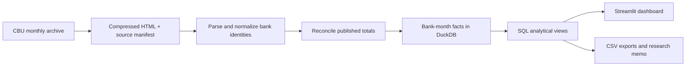

# Uzbekistan Banking Analytics

A completed study of growth, market shares, liquidity and funding in Uzbekistan's banking sector. Built from **56 official Central Bank publications**, with **889 bank-month observations**, **25 monthly snapshots** and **36 distinct banks**.

**Research result:** Deposit funding expanded, sector liquidity buffers increased and assets became less concentrated. The study identifies the banks and balance-sheet components behind these changes.

The dataset covers **1 January 2024 to 1 January 2026**, capturing the two full calendar years 2024–2025. This is a historical research project, not a live monitoring service.

[Русская инструкция](README.ru.md) · [Research findings](reports/findings.ru.md) · [Methodology](docs/methodology.md) · [Data dictionary](docs/data_dictionary.md)

## Results at a glance

- In 2025, deposits grew **35.2%**, or **26.0% after CPI adjustment**. Local-currency balances supplied **90.9%** of growth; legal entities supplied **65.0%** in the separate customer breakdown.
- Sector **LCR rose from 193.8% to 207.5%** and **NSFR from 115.3% to 119.9%**, exceeding the 100% minima reported by CBU.
- The top five banks' share of assets fell from **57.4% to 50.8%** over 2024–2025. Assets outside the initial top five grew **64.7%**, versus **24.8%** within that fixed cohort.
- An endpoint decomposition attributes **−4.21 percentage points** of the state-participation asset-share change to relative asset growth and **−0.06 points** to Poytaxt Bank's reclassification.
- **Octobank** led deposit-share gains; **Agrobank** added the largest deposit amount; **Kapitalbank** held the largest individual-depositor balance.
- Deposits funded **42.1%** of state-participation banks' liabilities and **72.1%** of other banks' liabilities at 1 January 2026.

Each of the [seven completed findings](reports/findings.ru.md) includes calculations, an explicit conclusion and primary-source links. Liquidity results use CBU's aggregate ratios. Currency, customer and maturity contributions are independent decompositions of the same deposit increase.

## Explore the project


- **Streamlit app:** five tabs covering the sector, bank comparisons, lending and funding, completed research, and source evidence. The research tab retains its labelled 2024–2025 study window. Date and metric selectors, indexed comparisons and CSV downloads are included. Interface language: Russian; normalized bank labels: English.
- **Portable report:** download and open [reports/overview.html](reports/overview.html) in a browser. Its interactive charts are self-contained and need no Python or internet. GitHub displays the HTML source; download the file to view it.
- **SQL analysis:** [seven result queries](sql/02_research_questions.sql), [core metrics](sql/01_marts.sql) and [research decompositions](sql/03_completed_research.sql).
- **Source evidence:** manifests cover [50 monthly publications](data/sources.json) and [six supplemental publications](data/research/sources.json), with URLs, retrieval timestamps and SHA-256 hashes. Compressed original HTML publications are included.

## Run locally

Python **3.12** is the validated version. Run all commands from this repository's root.

```bash
python -m venv .venv
```

Activate on Windows PowerShell:

```powershell
.\.venv\Scripts\Activate.ps1
```

Activate on macOS / Linux:

```bash
source .venv/bin/activate
```

Then:

```bash
python -m pip install -r requirements.txt
python -m pip install -e ".[dev]"
python -m uzbank.build
python -m uzbank.report
python -m pytest -q
python -m streamlit run app.py
```

The app opens at the local URL printed by Streamlit. On PowerShell, if activation is unavailable, invoke `.\.venv\Scripts\python.exe` directly instead of changing the machine's execution policy.

The processed CSVs are committed, so the dashboard can run immediately after installation. The build regenerates them and creates `data/processed/banking.duckdb` from the archived sources. **The build and tests do not contact CBU.** The direct dependency versions used for validation are pinned in `requirements.txt`.

## Source archive

The network step is separate and explicit:

```bash
python -m uzbank.fetch --start 2024-01 --end 2026-01
python -m uzbank.build
python -m uzbank.report
```

The downloader scans the official monthly archive, verifies the date inside each publication and caches already downloaded pages. Existing cached pages remain unchanged; to capture source revisions, use a separate checkout or back up and replace the relevant cached source files. The fetcher does not silently rewrite historical evidence.

The six supplemental publications are frozen in `data/research/` and parsed by the offline build. They supply comparative year-end currency, maturity, liquidity, capital and balance-sheet data, plus CPI from CBU's January 2026 monetary-policy decision. The study window is fixed at 2024–2025; period checks guard the published conclusions. A missing source or unknown format stops the build.

## Pipeline



| Layer | Contents |
| --- | --- |
| `data/raw/` | Original CBU HTML publications, compressed without altering content |
| `data/research/` | Six archived publications completing the funding and liquidity analysis |
| `data/banks.csv` | Explicit source-name aliases and stable bank IDs |
| `src/uzbank/` | Downloading, parsing, validation, database build and report generation |
| `sql/` | Market shares, YoY, concentration, funding and contribution decompositions |
| `data/processed/` | Reproducible CSV exports and reconciliation results |
| `app.py` | Interactive Streamlit dashboard |
| `tests/` | Source integrity, financial arithmetic, edge cases and app interactions |
| `.github/workflows/` | Offline rebuild and test workflow for GitHub Actions |

## Data quality decisions

- Balance-sheet stocks are **never summed over time**.
- Values in source data and CSVs are **UZS billion**. Main charts display **UZS trillion**.
- YoY compares the **exact calendar date one year earlier**, not an arbitrary preceding row.
- Missing or zero baselines produce unavailable growth, not a fabricated 0%.
- Ownership is the **CBU classification at each reporting date**. “Other banks” is not equated with “private domestic banks”.
- Smart Bank and Open Bank share one stable identifier, supported by the bank's [official name-change notice](https://openbank.uz/ru/about/announcement).
- Published integer balances are reconciled with rounding-aware tolerances. **764 reconciliations** pass: 750 monthly total checks and 14 supplemental-source checks. Cross-publication loans/deposits and retail/corporate decompositions are also checked.
- Market shares retain the full-sector denominator when a user selects a subset of banks.

See [methodology](docs/methodology.md) for definitions, analytical scope and reconciliation rules.

## Portfolio skills demonstrated

Source discovery and provenance, financial data cleaning, entity resolution, dimensional data modeling, SQL window functions and calendar joins, reproducible ETL, domain-aware validation, interactive BI and written analysis.

## Analytical scope

The completed study covers balance-sheet growth, ownership, concentration, deposit composition, liability structure, and aggregate liquidity and capital adequacy. Its perimeter is CBU commercial-bank statistics. Balances are measured on reporting dates; the CPI-adjusted result measures the purchasing-power change of the aggregate deposit stock. All seven conclusions are generated from reproducible outputs by `src/uzbank/findings.py`, shared by the memo, portable report and dashboard.

## License and attribution

Original project code and documentation are distributed under the [MIT license](LICENSE). CBU publications and extracted data are attributed to the **Central Bank of the Republic of Uzbekistan**; the project license does not relicense third-party material. See [data attribution](data/README.md).
