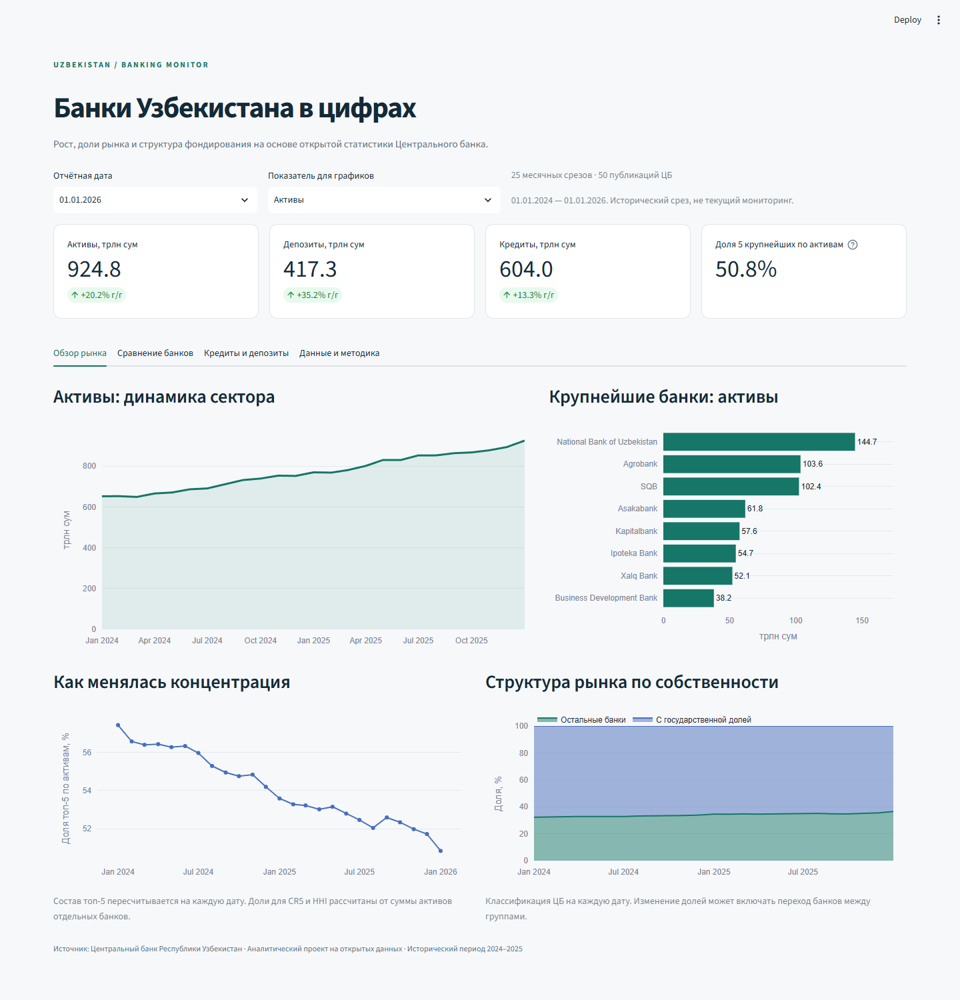
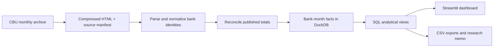

# Uzbekistan Banking Analytics

An end-to-end analytics project on the growth, market shares and funding structure of Uzbekistan's banks. Built from **50 official Central Bank publications**, with **889 bank-month observations**, **25 monthly snapshots** and **36 distinct banks**.

**Research question:** Which banks are gaining market share, and how is the relationship between loans and deposits changing?

The dataset covers **1 January 2024 to 1 January 2026**, capturing the two full calendar years 2024–2025. This is a historical research project, not a live monitoring service.

[Русская инструкция](README.ru.md) · [Research findings](reports/findings.ru.md) · [Methodology](docs/methodology.md) · [Data dictionary](docs/data_dictionary.md)

## Results at a glance

- In 2025, deposits increased **35.2%**, compared with **13.3%** for loans and **20.2%** for assets.
- The top five banks' share of assets fell from **57.4% to 50.8%** between January 2024 and January 2026.
- The sector loan-to-deposit ratio fell from **195.0% to 144.8%** over the same period.
- Banks with state participation accounted for **63.5%** of assets at the final date, compared with **67.7%** at the start.

These are descriptive findings. They do not establish causality, bank safety or regulatory compliance. Calculations and source links are in the [research memo](reports/findings.ru.md).

## Explore the project



- **Streamlit app:** four tabs covering the sector, bank comparisons, lending and deposits, and source evidence. Date and metric selectors, indexed comparisons and CSV downloads are included. Interface language: Russian; normalized bank labels: English.
- **Portable report:** download and open [reports/overview.html](reports/overview.html) in a browser. Its interactive charts are self-contained and need no Python or internet. GitHub displays the HTML source; download the file to view it.
- **SQL analysis:** [five research queries](sql/02_research_questions.sql) and the [metric definitions](sql/01_marts.sql).
- **Source evidence:** the complete [source manifest](data/sources.json) records reporting dates, URLs, retrieval timestamps and SHA-256 hashes. Compressed original HTML publications are included.

## Run locally

Python **3.12** is the validated version. Run all commands from this repository's root.

```bash
python -m venv .venv
```

Activate on Windows PowerShell:

```powershell
.\.venv\Scripts\Activate.ps1
```

Activate on macOS / Linux:

```bash
source .venv/bin/activate
```

Then:

```bash
python -m pip install -r requirements.txt
python -m pip install -e ".[dev]"
python -m uzbank.build
python -m uzbank.report
python -m pytest -q
python -m streamlit run app.py
```

The app opens at the local URL printed by Streamlit. On PowerShell, if activation is unavailable, invoke `.\.venv\Scripts\python.exe` directly instead of changing the machine's execution policy.

The processed CSVs are committed, so the dashboard can run immediately after installation. The build regenerates them and creates `data/processed/banking.duckdb` from the archived sources. **The build and tests do not contact CBU.** The direct dependency versions used for validation are pinned in `requirements.txt`.

## Reproduce or refresh the source archive

The network step is separate and explicit:

```bash
python -m uzbank.fetch --start 2024-01 --end 2026-01
python -m uzbank.build
python -m uzbank.report
```

The downloader scans the official monthly archive, verifies the date inside each publication and caches already downloaded pages. Existing cached pages remain unchanged; to capture source revisions, use a separate checkout or back up and replace the relevant cached source files. The fetcher does not silently rewrite historical evidence.

Extending coverage requires reviewing new bank aliases, source layouts, tests and narrative period labels. A missing source month stops the refresh. It never interpolates financial values. CBU can change its archive structure; unknown formats fail explicitly.

## Pipeline



| Layer | Contents |
| --- | --- |
| `data/raw/` | Original CBU HTML publications, compressed without altering content |
| `data/banks.csv` | Explicit source-name aliases and stable bank IDs |
| `src/uzbank/` | Downloading, parsing, validation, database build and report generation |
| `sql/` | Market shares, calendar YoY changes, CR5, HHI and ownership aggregates |
| `data/processed/` | Reproducible CSV exports and reconciliation results |
| `app.py` | Interactive Streamlit dashboard |
| `tests/` | Source integrity, financial arithmetic, edge cases and app interactions |
| `.github/workflows/` | Offline rebuild and test workflow for GitHub Actions |

## Data quality decisions

- Balance-sheet stocks are **never summed over time**.
- Values in source data and CSVs are **UZS billion**. Main charts display **UZS trillion**.
- YoY compares the **exact calendar date one year earlier**, not an arbitrary preceding row.
- Missing or zero baselines produce unavailable growth, not a fabricated 0%.
- Ownership is the **CBU classification at each reporting date**. “Other banks” is not equated with “private domestic banks”.
- Smart Bank and Open Bank share one stable identifier, supported by the bank's [official name-change notice](https://openbank.uz/ru/about/announcement).
- Published integer balances are reconciled with rounding-aware tolerances. **750 published-total checks** pass in the included dataset. Cross-publication loans/deposits and retail/corporate decompositions are also checked.
- Market shares retain the full-sector denominator when a user selects a subset of banks.

See [methodology](docs/methodology.md) for definitions, limitations and reconciliation rules.

## Portfolio skills demonstrated

Source discovery and provenance, financial data cleaning, entity resolution, dimensional data modeling, SQL window functions and calendar joins, reproducible ETL, domain-aware validation, interactive BI and written analysis.

## Scope and possible extensions

The current project uses CBU regulatory statistics. It does not combine these with consolidated IFRS statements. A separate next phase could add audited profitability and cost metrics for selected banks after aligning accounting scope, dates and definitions. Payment-system volumes are another distinct extension; bank-level balance sheets do not contain transaction success rates or customer retention.

## License and attribution

Original project code and documentation are distributed under the [MIT license](LICENSE). CBU publications and extracted data are attributed to the **Central Bank of the Republic of Uzbekistan**; the project license does not relicense third-party material. See [data attribution](data/README.md).
